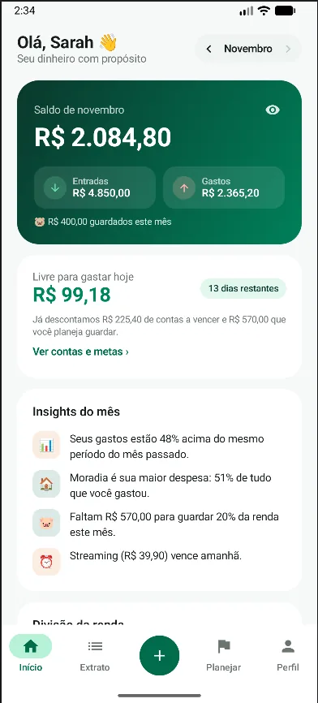
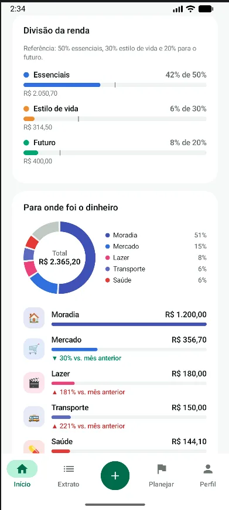
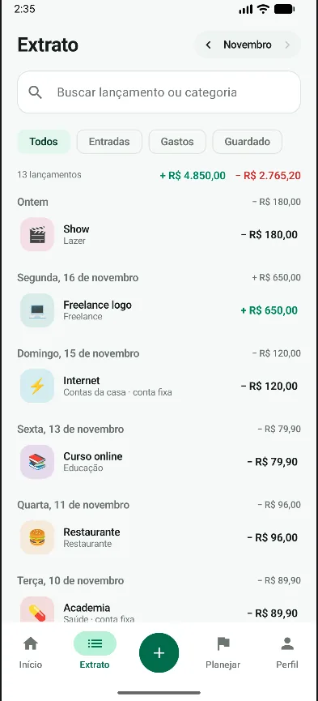
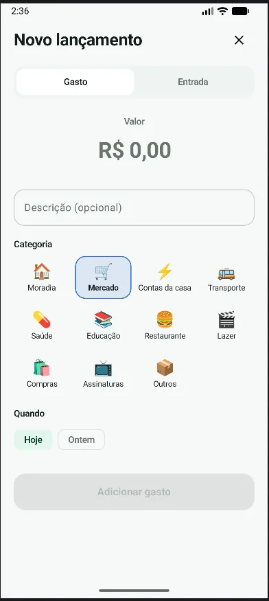
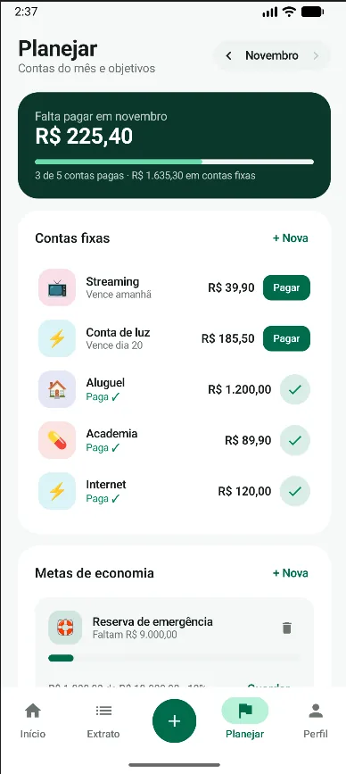
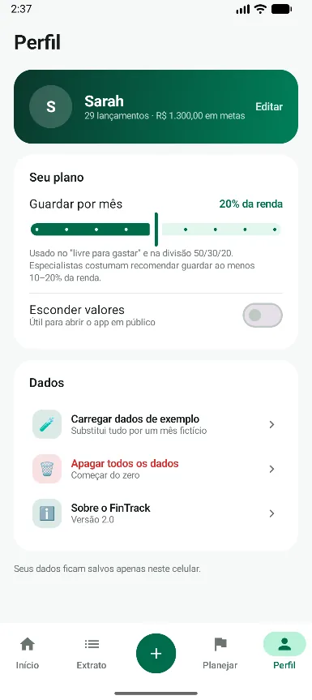

# FinTrack

Aplicativo Android de finanças pessoais para registrar entradas e gastos, acompanhar contas fixas e juntar dinheiro para metas, usando a regra **50/30/20** como referência.

Feito em **Kotlin** com **Jetpack Compose**. Os dados ficam salvos no próprio celular, sem login e sem internet.


## Telas

| Início | Divisão da renda | Extrato |
| --- | --- | --- |
|  |  |  |

| Novo lançamento | Planejar | Perfil |
| --- | --- | --- |
|  |  |  |

## Funcionalidades

### Início
- Resumo do mês: o que entrou, o que saiu e quanto sobra.
- Divisão dos gastos pela regra 50/30/20: **Essenciais**, **Estilo de vida** e **Futuro**.
- Gráfico de rosca com as categorias em que você mais gasta e a comparação com o mês anterior.
- **Dicas automáticas**, por exemplo:
  - gastos acima ou abaixo do mês passado;
  - estilo de vida passando do limite ideal;
  - contas fixas vencendo ou atrasadas;
  - quanto falta para bater a meta de guardar do mês.

### Extrato
- Lançamentos agrupados por dia, com o saldo de cada dia.
- Busca por nome ou categoria.
- Navegação entre os meses.
- Exclusão de lançamentos.

### Novo lançamento
- Escolha entre **Gasto** e **Entrada**.
- O valor é formatado em real enquanto você digita (ex.: `1.234,56`).
- Categorias com emoji e opção de registrar o lançamento como "ontem".

### Planejar
- **Contas fixas**: aluguel, internet, assinaturas etc., com dia de vencimento e um botão **Pagar** que lança o pagamento no extrato.
- **Metas**: objetivos de economia (viagem, reserva de emergência...) com barra de progresso. O valor guardado aparece no extrato como "Guardado".

### Perfil
- Nome do usuário.
- Percentual da renda que você quer guardar por mês.
- Opção **Esconder valores**, que troca os valores por `R$ ••••`.

## Categorias

| Grupo | Categorias |
|---|---|
| Renda | Salário, Freelance, Rendimentos, Outras entradas |
| Essenciais | Moradia, Mercado, Contas da casa, Transporte, Saúde, Educação |
| Estilo de vida | Restaurante, Lazer, Compras, Assinaturas, Outros |
| Futuro | Guardado (valores enviados para metas) |

## Tecnologias

- Kotlin 2.2
- Jetpack Compose com Material 3
- `AndroidViewModel` para o estado das telas
- `SharedPreferences` com JSON para guardar os dados no aparelho
- Android Gradle Plugin 9.3
- `minSdk` 24 (Android 7.0) e `targetSdk` 37

## Arquitetura

O app segue o padrão **MVVM** com uma única fonte de estado:

```
Telas (Compose)            InicioView, ExtratoView, NovaTransacaoView, PlanejarView, PerfilView
      │  observam o estado e chamam ações
      ▼
FinancasViewModel          regras de negócio: totais do mês, regra 50/30/20,
      │                    contas pendentes, progresso das metas, dicas automáticas
      ▼
Armazenamento              serializa transações, contas e metas em JSON
      │
      ▼
SharedPreferences          dados salvos no próprio aparelho
```

- As telas não têm lógica de cálculo: só exibem o estado e repassam eventos ao ViewModel.
- O `AndroidViewModel` sobrevive à rotação de tela e centraliza toda a regra de negócio.
- Os modelos (`Transacao`, `ContaFixa`, `Meta`, categorias) ficam separados em `Transacao.kt`.

## Estrutura do código

Os arquivos ficam em `app/src/main/java/com/example/fintrack/`:

| Arquivo | O que faz |
|---|---|
| `MainActivity.kt` | Ponto de entrada e navegação entre as telas |
| `Tela.kt` | Abas da barra de navegação inferior |
| `FinancasViewModel.kt` | Regras de negócio: totais, contas, metas e dicas |
| `Transacao.kt` | Modelos: `Transacao`, `ContaFixa`, `Meta` e as categorias |
| `Armazenamento.kt` | Salva e carrega os dados no aparelho |
| `Formatacao.kt` | Formatação de moeda, datas e a máscara de valor |
| `Componentes.kt` | Componentes visuais reutilizados (gráfico, item de lançamento...) |
| `InicioView.kt`, `ExtratoView.kt`, `NovaTransacaoView.kt`, `PlanejarView.kt`, `PerfilView.kt` | Telas do app |
| `ui/theme/` | Cores, tipografia e tema |

## Como rodar

1. Clone o repositório:

   ```bash
   git clone https://github.com/shandriasarah/FinTrack.git
   ```

2. Abra a pasta no **Android Studio** e espere o Gradle sincronizar.
3. Escolha um emulador ou conecte um celular e clique em **Run ▶**.

Para gerar o APK pela linha de comando:

```bash
./gradlew assembleDebug
```

O arquivo fica em `app/build/outputs/apk/debug/`.

## Autora

Desenvolvido por **Sarah Shandria**, estudante de Ciência da Computação.

[LinkedIn](https://www.linkedin.com/in/sarah-shandria-727b86376/) · [GitHub](https://github.com/shandriasarah)
